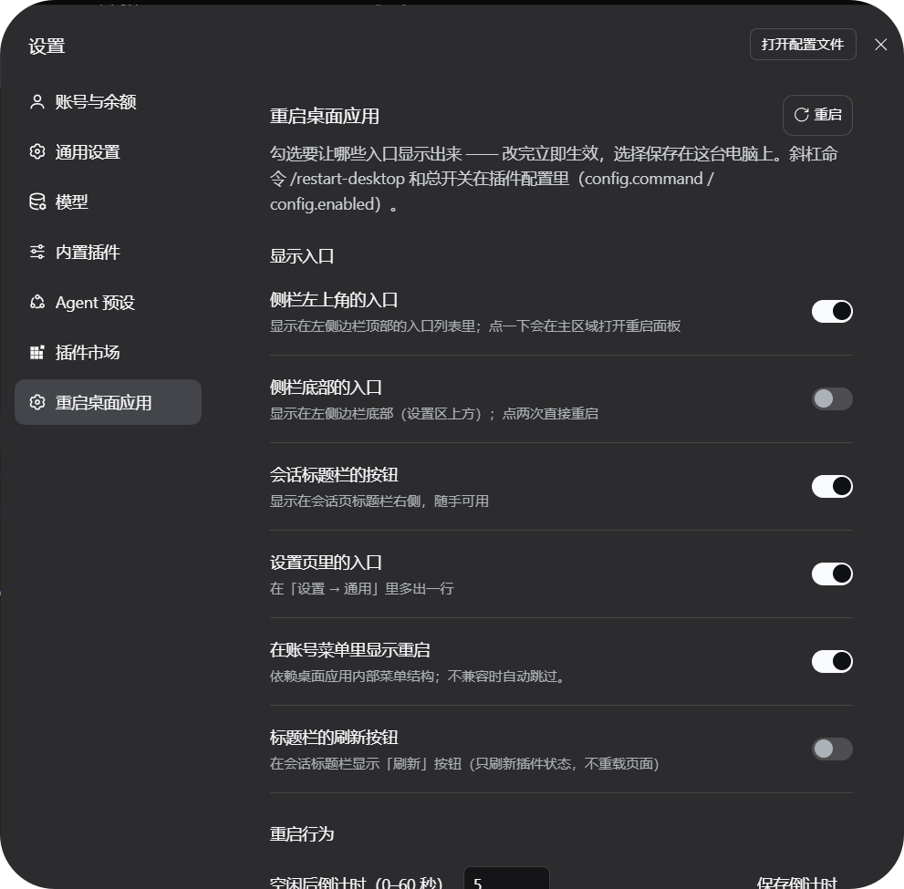
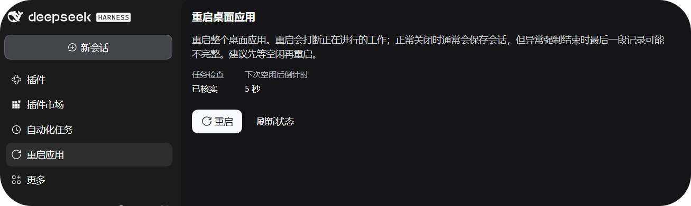

# One-click restart for the desktop app · dsh-desktop-restart

**Adds a "restart" button to DeepSeek Harness Desktop.** One click: the app shuts down and
comes back by itself — sessions still flush to disk, it asks first when you are busy,
and it tells you how it went.

English | [简体中文](README.md)



---

## Why this exists

DSH Desktop ships no restart entry point. Today you have two options:

| What you do now | What it costs |
| --- | --- |
| Close the window, then hunt for the shortcut again | Background processes are easy to miss — the window is gone, the process is not |
| Find it in Task Manager and end it | You must pick the right one of several identically named processes, and ending it too early can tear a session log mid-write |

The more common problem is simpler: **you restart by accident while the AI is working.**
Code generation, tool calls, batch jobs — interrupted means starting over.

This plugin turns "restart" into a button, and closes each of those gaps.

---

## Usage

Four things it actually does:

### 1. Six entry points, wherever you already are


| Entry | Where | Interaction |
| --- | --- | --- |
| Sidebar top | Top of the left sidebar entry list | One click opens the restart panel in the main area |
| Sidebar footer | Bottom of the left sidebar, above Settings | Two clicks restart directly |
| Conversation header | Right side of the conversation header | Two clicks restart directly |
| Account menu | First item in the bottom-left avatar menu | Two clicks restart directly |
| Slash command | Type `/restart-desktop` in the composer | Enter restarts |
| Settings → General | A read-only status row | Shows status only, never restarts |

Turn off any entry you do not want in **Settings → Restart desktop app**. Changes apply
immediately — no app restart needed.

### 2. It will not force its way through your work

This is the main difference from a plain `taskkill`. When work is running — a reply being
generated, a tool executing, queued messages, background jobs — a single click does **not**
restart:

1. **First click**: the button turns red, the label becomes "Restart anyway?", and it says
   exactly what will be interrupted.
2. **Second click**: it goes ahead.
3. Or pick **"Wait until idle"**: it watches and fires when the work finishes
   (30 minutes maximum; on timeout it says plainly that no restart happened).

The red warning **expires after 15 seconds** so a stray click cannot restart the app while
you are away (configurable, 5–60 seconds).

> **While the plugin itself is installing or updating, restarts are hard-blocked** —
> ending the process then would corrupt the dependency install. Even `force` will not get
> through. Wait for it to finish (usually a minute or two).

### 3. Sessions always finish writing before it stops

This is the part it refuses to compromise on:

It ends **only the Electron main process**, and **deliberately without `/T`** (no tree kill).
The host child process therefore survives, receives the IPC disconnect, and runs its own
graceful shutdown — so session logs land on disk properly.

`/T` would kill the host too. That is what actually loses data.

> Note: the reply currently being generated is still interrupted and is not resumed
> automatically. **This plugin does not send messages to sessions** — it will not
> continue the conversation or replay tool calls for you.

### 4. You get a receipt afterwards

When the restart completes, the panel tells you three things:

- **How long the downtime was** (from request to the new host being ready)
- **Whether the new instance came up**
- **Whether the port was matched** (it says "port not obtained" rather than inventing one)



The receipt has a stated limit: it proves **the new host loaded this plugin**. It does not
mean every plugin and background job has recovered.

---

## Install

```sh
dsh plugin add @luoshuizhiwei/dsh-desktop-restart
```

**Restart the app once by hand** after installing — the plugin is not running yet, so that
first time it cannot help. After that you never need to.

---

## What it guards against

"Can restart" is not "should restart". The app's own quit flow first asks the host what
would be interrupted; this plugin ends the main process directly and therefore bypasses
that check. So it supplies two equivalent guards:

| Guard | Signal | Blocks | Way out |
| --- | --- | --- | --- |
| Work running, or liveness unknown | The `agents` and `jobs` services | Sessions, tool calls, queued messages, background jobs | Normal requests wait; new work during a countdown pauses and asks; an explicit confirmation can still execute |
| Plugin installing/updating | The process recorded in `<profile>/.plugin-manager/run.json` **is alive right now** | Built-in plugin manager, marketplace, any `dsh plugin` operation | **Hard block**, `?force=1` included |

Two details worth calling out:

- **The signal is "is the process alive", not "does a file exist".** `run.json` survives a
  hard kill; keying on file presence would lock the restart button forever.
- **The host decides when work changes.** Re-checked every 5 seconds while waiting, up to
  once per second during a countdown. Only one ask token is created per change, offering
  three choices: keep waiting / restart now / cancel. Keeping waiting recomputes the full
  countdown without extending the original deadline.

---

## Known limitations

Stated limits say more about reliability than a feature list. What it will not do:

- **It will not recover interrupted work.** No resuming conversations, no replaying tool
  calls, no messages delivered to sessions.
- **It will not pass off a guess as "UI downtime".** The panel reports handoff time, not a
  frame-accurate window blackout.
- **It will not kill anything it cannot verify.** Identity mismatch, unreadable process
  table, insufficient permission — it aborts and records why, instead of "probably that
  one, let's try".
- **It deletes no snapshot files** unless you explicitly enable candidate deletion and
  confirm a second time.
- **It does not raise request-header limits** or alter the app's authentication.
- **It does not sit inside the host process waiting for its own restart** — that would kill
  the watcher too. A design choice, learned the hard way.

---

## When something goes wrong

Occasionally a restart does not close out cleanly: the old instance would not exit, the new
one was not confirmed in time, or a disk-cleaning tool / antivirus touched the records. The
panel then states the reason in plain words and keeps a **redacted** diagnostic (no process
paths, command lines or credentials).

| What you see | What it means | What to do |
| --- | --- | --- |
| Result unknown | No receipt arrived; the app may be up | Check the window first; if normal, mark it read |
| Operation record missing | The intermediate record became unreadable | Confirm the window is normal, then "I checked — clear restart state" |
| Record has no start time | The state may be stale | Verify the window recovered; reopen by hand if needed |
| Old instance would not close | The main process did not exit; restart aborted | End that process manually and retry (the reason distinguishes "still running" from "cannot probe") |
| Identity unverifiable | Antivirus blocked the process query | Allow it and retry, or restart by hand |

Two rules that keep this quiet:

- **A successful restart auto-closes earlier "result unknown" notices**, folding them into
  the read section — success is an answer to the earlier doubt; it should not stay in
  warning colours.
- **Diagnostic records are never auto-deleted.** Only read records beyond the retention
  count are reclaimed. Delete the read marker to restore one.

---

## Three small extras

Unrelated to restarting; they ride along. **Each can be turned off.**

### Sign-in data health check

DSH stores a sign-in credential on every launch and never prunes them. Enough of them and
the app can **fail to start**.

Settings shows the last check: how much is used, the 16 KiB default limit, and the count.
**By default it only checks during a restart through this plugin** (when the database is not
busy).

> Sampling and backup open the database **read-only**. **Only "prune old sign-in tokens"
> writes to it** — that step backs up first, then trims redundant `dsh-auth-*` entries down
> to the newest 3; if the backup fails, nothing is deleted that round.

### Leftover temporary-file preview

DSH leaves snapshot copies in the system temp directory when diffing changes; a crash can
strand them.

**By default it scans and previews only, deleting nothing** — there is no reliable way to
tell which copy another instance is still using. It reports how many candidates it found and
roughly how much space they take; deleting is your call (enabled separately, with a second
confirmation).

### Hide "Feedback" in the account menu

"Feedback" sits right under "Settings" in the account menu and opens an external page — easy
to hit by accident.

This switch hides it (**off by default**). If the item cannot be identified, nothing happens —
it would rather leave it than touch the wrong entry.

---

## FAQ

**Will a restart lose data?**
A normal shutdown saves sessions. The plugin ends only the Electron main process and lets the
host exit gracefully so session logs flush. A reply being generated is still interrupted and
will not resume automatically.

**Why not use one of those "restart dsh web" plugins?**
The desktop app's process model is entirely different from `dsh web` in a terminal; those
plugins cannot work there. See the first technical section.

**The button says "locked" and will not respond.**
A wait or countdown is in progress. Use "Cancel wait" next to it.

**The red "Restart anyway?" is stuck.**
It expires after 15 seconds. If it never clears, status reading is broken — hit "Refresh status".

**The app fails to start after installing the plugin.**
Most likely too much sign-in data. Quit the app fully, delete
`%APPDATA%\@deepseek-ai\dsh-desktop\Network\Cookies`, then reopen (the file recreates
itself; you will need to sign in again).

**Why did my toggles change on another machine?**
Toggles travel with the profile (they live in the plugin settings file), not with the browser.
That is deliberate: it prevents the old "change a toggle, restart immediately, toggle snaps
back" problem.

---

# Technical details

For anyone interested in the implementation or contributing. Not needed for daily use.

## Why a dedicated plugin is required

The desktop process model is nothing like `dsh web` in a terminal:

```
DeepSeek Harness.exe            ← Electron main: window, tray, auto-update
  └── DeepSeek Harness.exe      ← host child (same exe + ELECTRON_RUN_AS_NODE=1)
        └── this plugin         runs dsh-desktop-host, listening on 127.0.0.1
```

Two consequences follow:

1. **The host exiting is not an app restart.** The main process treats a child exit as a
   fault and shows a recovery dialog (whose default button is "restart the app") — workable,
   but it needs a human click every time.
2. **The main process gives plugins no restart channel.** The full IPC surface is
   `shutdown` / `quit-inspection` / `update-tasks` (main→host) and `ready` / `fatal` /
   `shutdown-complete` / `platform-session` (host→main); the renderer-side `DESKTOP_IPC`
   table has no restart either. The built-in "restart app and host" menu item is only added
   in development builds.

So a one-click restart must come from **outside the host**.

## The nine steps of a restart

1. An entry sends a **same-origin POST** to the plugin's own host route.
2. The host applies the install hard-guard, then holds a state machine of
   waiting / countdown / paused-ask / executing. Normal requests wait for verified idleness;
   an explicit immediate request still has to clear the install and identity guards.
3. On success it writes a handoff descriptor, spawns a **detached helper** using
   `process.execPath` (the app itself) with `ELECTRON_RUN_AS_NODE=1`, and returns `202`
   immediately. The helper needs neither a system Node nor `dsh` on PATH.
4. The helper waits 1.5 s so the response reaches the browser first, then reads the main
   process's **command line and executable path** while it is still alive (arguments must be
   preserved; the path identifies the target for a last-resort kill).
5. The helper ends the **Electron main process**, **deliberately without `/T`** (see
   "Sessions always finish writing" above).
6. It waits for the main process to disappear, then for the listening port to be released —
   probed by **connecting**, not binding: a speculative bind would occupy exactly the port
   the replacement needs.
7. If the port lingers, it only touches leftovers provably belonging to this instance by
   **parentage, path and start time**. Never widened by image name, never a same-path
   sibling instance; when identity cannot be proven it aborts and records why.
8. It relaunches with a **clean environment** — `ELECTRON_RUN_AS_NODE` must be removed,
   otherwise the new "app" starts in Node mode as a windowless process. If the new instance
   exits immediately it retries (3 attempts by default), and only then gives up with a dialog
   asking for a manual launch.
9. The handoff directory keeps the last 20 handoff/log sets; per profile, the last 20
   completed operation records are kept reclaimable. Pending, unknown and
   unread-referenced records are protected.

## Three identity checks: what earns it the right to kill

Ending a process by PID risks two failures: **killing the wrong one** (PID reuse) and
**killing blind** (unreadable process table). This version tightens both:

1. **A full re-read immediately before the kill.** The earlier snapshot only establishes
   *who the target is*; it never authorizes a kill. Right before `taskkill`, a fresh process
   table is compared on **PID, parent PID, executable path and creation time** — all four
   must match.
2. **Only `ESRCH` counts as "already exited".** Signal-0 probing is three-valued:
   - `ESRCH` (no such process) → confirmed gone, skip the kill and continue
   - `EPERM` / `EACCES` (insufficient permission) → **unverifiable, refuse** — never
     treated as "disappeared"
   - Empty table, or the target row missing while the PID is still alive → **suspected
     reuse, refuse**
3. **When antivirus blocks the process query, it refuses rather than degrading.** Identity
   checking depends on a system CIM query. If antivirus blocks hidden PowerShell execution
   and the table comes back incomplete, the restart **aborts with a stated reason** instead
   of "we cannot see clearly, so kill without checking". Better to do nothing than to kill
   blind.

One more gate afterwards: it waits for the main process to **actually disappear** (again only
`ESRCH` counts). On timeout it reports `stop-failed` and **does not launch a replacement** —
starting a second instance over a half-dead one only makes things worse.

## Receipts

A receipt is bound to the **current profile, install instance and restart identifier**; the
helper hands that identifier only to the instance it launched, and the new host claims and
**consumes it once** within a short window. A failed schedule invalidates the record.

The receipt separates request time from **host-ready time**. It proves the new host loaded
the plugin; it does not mean the whole UI, every plugin or all background jobs recovered.
The panel calls `downtimeMs` **handoff time**, not frame-accurate UI downtime.

**A receipt may arrive late, and it will be waited for.** On real machines the new instance
can take over ten seconds to load this plugin, so beyond the main wait window there is a
20-second grace poll; and after that, before deciding "result unknown", there is one final
re-read. That recheck is not theoretical neatness — it has already caught a false alarm on a
real machine: the receipt landed in the gap between "main window closed" and "window probe
started", and the older logic would have called a success "unknown". The match is proven by
the nonce (id, profile, and the `hostReadyAt` / `clientReadyAt` ordering), not by the port
and not by the process table.

## Mutual exclusion: two instances wanting to restart

Cross-process exclusion uses `desktop-restart/restart.lock` (atomic creation plus stale-lock
takeover).

Taking over a stale lock is careful work: a `restart.lock.recovery` marker first expresses
"I am inspecting", then the old holder's PID must be proven gone (again only `ESRCH`;
permission errors and unverifiable states count as refusal). **The recovery marker belongs to
its writer**: if the writer died (crashing between "create marker" and "clean up"), takeover
uses an **atomic `rename`** — on Windows renaming onto an existing target fails, so exactly
one of two competitors wins. That rules out "B uses stale evidence to delete A's new marker
and new lock". Alive or unverifiable holders are refused with a manual way out.

## Stage timings

A restart's cost is split into checkable stages, written to the operation record (visible in
both the panel and diagnostics):

| Stage | Covers |
| --- | --- |
| `verify` | Handoff confirmation, identity verification, argument recovery |
| `stop` | Ending the main process until exit is confirmed |
| `portWait` | Waiting for the port to be released (including leftover cleanup) |
| `launch` | Launch attempts and the survival check |
| `readyWait` | Waiting for the receipt plus the grace poll |
| `ready` | Closing out: window probe, final re-read, writing the verdict |

Splitting them makes "where is it slow" obvious. `launch` used to absorb the entire
receipt wait, so a 2.6-second launch looked like 24 seconds — the remainder is **the new
instance loading this plugin**, which the plugin cannot influence and should not be blamed
for.

## Interface conventions

The UI uses **official primitives**, not lookalikes:

- The top sidebar row occupies the official panel seat (`sidebar.panellist`): the plugin
  registers `id / order / label` plus an icon component, and the sidebar draws the row
  itself — so it cannot look unofficial.
- The main panel follows the same seat's page layout (task board): full height, official
  background, 16px/700 title on the same line as the top-right status word.
- The footer entry occupies `sidebar.footer.action`, copying the 42px action row of the
  existing occupant; it becomes a 36×36 circle when the sidebar collapses to a rail.
- The header button copies the real official button in that seat.
- Colour semantics use official tokens: danger red for confirmation and warning, a secondary
  warning tone for waiting/countdown, error colour for failure; with reduced motion enabled
  it does not spin.
- Official components are declared in `dsh.client.inject` so the loader registers them
  before this plugin runs; if upstream renames or moves a package and the require fails, it
  falls back to its own styles copied **verbatim** from official values.

Full cross-reference (official CSS word-for-word plus upstream source paths) is in
`docs/official-ui-standard.md`.

## Toggles and configuration

Entry toggles are **on by default** (the general-settings row and the header refresh button
default to off; the account-menu item still has to pass a structure check). The
`/restart-desktop` slash command is unaffected by these toggles: it is controlled by the
`command` config key and accepts no settings-page write.

Toggles live in the **plugin settings file** `~/.dsh/desktop-restart/settings-<profile>.json`.
Not in browser localStorage, because a plugin restart is a **hard kill**: localStorage writes
Chromium has not flushed are lost — which shows up as "change a toggle, restart immediately,
the toggle snaps back". The settings file survives hard kills; localStorage is only a
per-page cache.

**Defaults** come from the plugin config, in the plugin's row in
`~/.dsh/profiles/<profile>/cordis.patch.yml`:

```yaml
config: { panel: false, footer: false, header: false, settingsRow: false, accountMenu: false, command: false, enabled: false }
```

| Toggle | When off |
| --- | --- |
| Top sidebar panel entry | The top sidebar row disappears (and with it the main-area panel) |
| Sidebar footer entry | The footer row disappears |
| Conversation header button | The header button disappears |
| Header refresh button | The "refresh" control disappears (off by default) |
| Settings → General row | The read-only status row disappears |
| Account menu entry | The restart item disappears from the account menu |

## Sign-in cookie health check

Settings shows the last downtime check: the estimate, the 16 KiB default limit, the auth
cookie count and the check time. It is a **downtime sample, not live monitoring**; with no
sample it says "no downtime check yet", and ordinary manual starts/exits do not refresh it.

"Back up the cookie database on restart" is off by default; the "80% early warning" is on.
The sampling and backup connection is **always read-only**; an optional consistent backup
keeps the newest 3.

"Prune old sign-in tokens on restart" is off by default. When enabled, each restart through
this plugin (after the old instance has fully exited) trims redundant `dsh-auth-*` rows on
`127.0.0.1` down to the newest 3 — the **only** action that writes to the database: it backs
up first and only deletes when the backup succeeded, otherwise nothing is deleted that round.
Keeping 3 is a safety margin: whether the host accepts only one token cannot be proven by a
plugin.

The check runs on a worker thread with an 8-second budget, then terminates and joins, so a
stuck database cannot stall the restart. Backups write `.partial` first then rename; only
complete files take part in retention. Raw stdout/stderr of the new instance is **not**
written to diagnostics by default (it contains tokens and other private strings); enable it
explicitly with `DSH_DESKTOP_RESTART_CAPTURE=1` when diagnosing.

> Upstream DSH 0.2.2 fixed the root cause of "accumulated auth data prevents startup", and
> the measured cookie database has returned to baseline. This feature is therefore more of a
> **sentinel**: quiet normally, early warning if upstream ever regresses.

## Temporary snapshot preview

DSH's change-comparison snapshots live in the system temp directory as
`dsh-workspace-changes-*`; a crash can strand copies, but **age alone does not prove an
orphan**.

A candidate must be a real directory with the exact prefix, created before this host started,
at least 24 hours old, and with no writes anywhere in its tree since startup. Symlinks,
junctions, unreadable or incompletely checkable trees are conservatively skipped.

Results report scanned count, candidate count, estimated size and the reason nothing was
deleted — **candidate size is never presented as freed space**. Deleting candidates is a
separate switch (off by default) requiring a second confirmation; the preview path never
deletes.

## API

`GET /dsh-desktop-restart/api/status` returns `restartRequest` with `state`
(idle / waiting / countdown / paused / executing / terminal), `countdownRemainingMs`,
`countdownUntil`, `deadlineAt`, `pausedReason` and `ask`.

`POST /dsh-desktop-restart/api/restart?choice=wait|now|cancel` is only valid while paused;
new clients also send `ask` and `request` (the original request id). **Both cancellation and
immediate execution bind to the original request**: if an active request exists and the id is
missing or mismatched, the reply is 409 — so a late cancellation or confirmation from another
window cannot damage the restart you just queued. `terminal` is history, not an active
request; cancelling it is an idempotent no-op.

`POST /dsh-desktop-restart/api/prefs?countdown=<integer>` saves the next countdown (0–60);
out-of-range or non-integer returns 400 without changing the stored value.

`POST /dsh-desktop-restart/api/prefs?clearOp=1` clears a completed restart state (the
"I checked — clear restart state" action). Only terminal states or missing records are
accepted; a `restart.lock` still held by a live process returns 409.

The client only mirrors host state: polling every 2 seconds while waiting/counting
down/restarting, slowing to every 5 seconds when unread diagnostics exist. Countdown display
is computed from the host's `countdownUntil` plus a local one-second clock and **cannot
decide execution**.

## Security model

`POST /api/restart` completes every check before acting:

| Check | Rejection |
| --- | --- |
| Method is not POST | `405` with `Allow: POST` |
| TCP peer is not loopback | `403` |
| `Host` is not a loopback name | `403` |
| Carries `forwarded` / `x-forwarded-for` / `x-real-ip` | `403` |
| No browser session credential | `401` |

When the platform auth service is unavailable, write routes return `503` rather than
allowing through. Settings writes likewise require same-origin POST and accept exactly one
key per request: unknown entries, `command`, multiple keys, duplicate keys and malformed
JSON all return `400`.

## Diagnostics and settings storage

Host settings use `desktop-restart/settings-<profileId>.json`, isolated per profile
directory identity. When the new file is absent and a legacy `settings.json` exists, the new
file is created exclusively and copied once; the old file's contents are preserved.

Failed and unconfirmed outcomes create one **redacted** diagnostic per "operation id +
outcome class" and attempt a Windows toast. Without permission or confirmed delivery the
plugin still shows an unread reminder until you mark it read. Diagnostic content excludes
process paths, command lines and credentials.

Once a restart is **confirmed recovered** by the new instance, the host auto-marks earlier
unread diagnostics as read (the marker carries `auto` and the closing restart id), folding
them into the read section; the records themselves are kept, and deleting the read marker
restores them.

## Testing and acceptance boundaries

- Package version `0.4.11`.
- **Verified on a real machine**: the full restart chain (including downtime measurement and
  receipts), toggles surviving a hard kill, a late receipt no longer being misreported as
  "unknown", pre-kill identity verification, account-menu first-open injection, panel button
  states, log redaction, cookie sampling.
- **Offline coverage**: three VM regressions (host, client, helper process/snapshot
  behaviour) covering one-shot consumption, cancellation and binding, failure rollback,
  retries, localisation, cross-instance isolation, lock takeover and preview protection. CI
  runs these on Ubuntu Node 20/22/24 and Windows Node 24.
- **Not yet verified**: screen readers, frame-by-frame visual stability, keyboard menu
  navigation, manual reproduction of multi-window concurrency, pixel layout across themes
  and narrow widths. Source-regex checks are not real UI acceptance.
- Core restart requires Node.js ≥ 20; the cookie health check requires Node.js ≥ 22.16
  (`node:sqlite`) and is skipped automatically on older versions.
- Development commands: `npm test` (nine chains), `npm run lint`.
