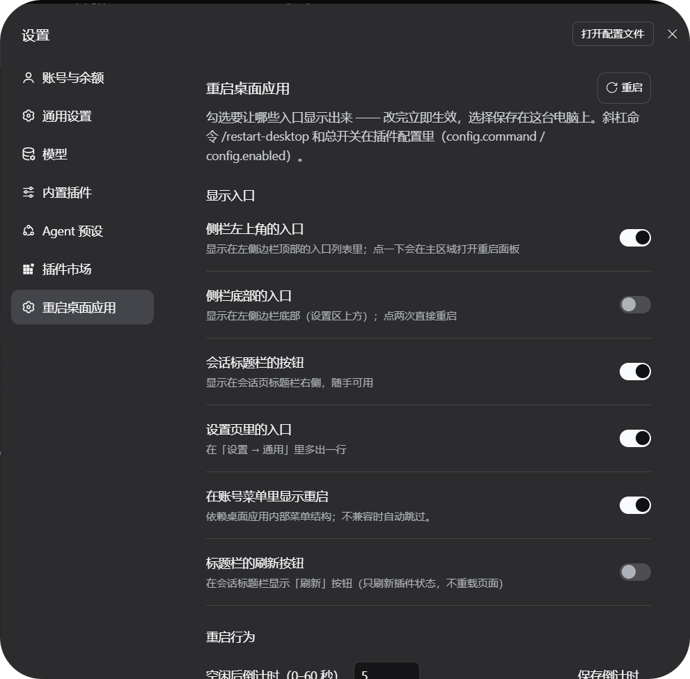
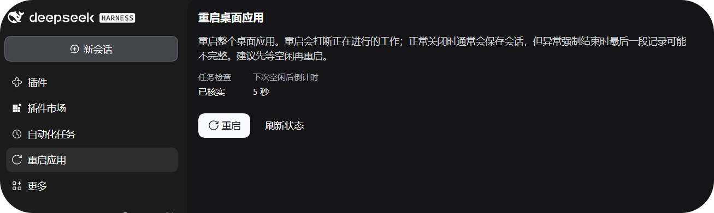

# 桌面应用一键重启 · dsh-desktop-restart

**给 DeepSeek Harness 桌面版加一个「重启」按钮。** 点一下，应用自己关掉再打开——
会话照常落盘，你正忙的时候它会先问你，重启完会告诉你结果。

[English](README.en.md) | 简体中文



---

## 为什么需要它

桌面版没有重启入口。想重启，眼下只有两个办法：

| 现在的办法 | 代价 |
| --- | --- |
| 关掉窗口，再重新找快捷方式打开 | 容易漏掉后台进程——窗口没了，进程可能还在 |
| 去任务管理器结束进程 | 得找对那一个（好几个同名进程），结束早了会撕坏正在写的会话 |

而更常见的麻烦是：**你正让 AI 干活时手一抖重启了**。写代码、跑工具、批量处理，
这些被打断就得从头再来。

这个插件把「重启」做成一个按钮，并把上面这些坑逐个填掉。

---

## 怎么用

四条核心能力：

### 一、六个入口，放在你顺手的地方


| 入口 | 位置 | 交互 |
| --- | --- | --- |
| 侧栏顶部 | 左边栏最上方的入口列表里 | 点一下，主区打开重启面板 |
| 侧栏底部 | 左边栏最下方（设置按钮上方） | 点两次直接重启 |
| 会话标题栏 | 对话页抬头右侧的操作区 | 点两次直接重启 |
| 账号菜单 | 左下角头像菜单的第一项 | 点两次直接重启 |
| 斜杠命令 | 输入框里打 `/restart-desktop` | 回车即重启 |
| 设置 → 通用 | 一行只读状态 | 只显示状态，不会重启 |

不想要的入口可以在 **设置 → 重启桌面应用** 里逐个关掉，**改完立即生效，不用重启**。

### 二、你忙着的时候，它不会硬来

这是本插件与「直接 taskkill」最大的区别。检测到有活干的时候（正在生成、正在执行工具、
有排队消息、有后台任务），点一下**不会**重启：

1. **第一击**：按钮变红、文字变成「仍要重启？」，并说清会打断什么
2. **第二击**：才真的执行
3. 或者选 **「等空闲再重启」**：它盯着，等活儿干完自己动手（最长等 30 分钟，超时会明说「没有执行重启」）

红色警告 **15 秒后自动消失**，避免你走开后误碰（可在设置里改成 5–60 秒）。

> **插件自己正在安装或更新时，重启会被硬拦** —— 那会儿结束进程会把依赖装坏。
> 带 `force` 也过不去，等它装完（通常一两分钟）就好。

### 三、一定等会话写完才关

这是「不丢数据」的关键，也是本插件最不愿妥协的一处：

它结束的**只有 Electron 主进程**，**故意不带 `/T`**（不连坐子进程）。宿主子进程因此
能活着收到 IPC 断开，走自己的优雅关闭流程，把会话日志正常落盘。

带 `/T` 会把宿主一起强杀 —— 那才会真丢数据。

> 说明：正在生成的那一轮回复仍会被打断，这部分不会自动恢复，**本插件不向会话投递消息**，
> 也不会替你续跑。

### 四、关完给你一张回执

重启完，面板告诉你三件事：

- **停机了多久**（从发起到新宿主恢复的耗时）
- **新实例起来没有**
- **端口对上没有**（对不上会说「端口未取得」，但仍判定成功——不伪造证据）



回执的边界也说清楚：它证明**新宿主已经加载了本插件**，不代表你的所有插件和后台任务都已恢复。

---

## 安装

```sh
dsh plugin add @luoshuizhiwei/dsh-desktop-restart
```

装完**手动重启一次应用**（这第一次插件还没跑起来，只能手动）。之后就不用管了。

---

## 它拦得住什么

「能重启」不等于「该重启」。应用自己的退出流程会先问宿主「现在停掉会打断什么」，
有就弹窗问用户；而本插件走的是直接结束主进程，绕过了那道检查。于是补上等价的两道守卫：

| 守卫 | 判据 | 挡住谁 | 出路 |
| --- | --- | --- | --- |
| 有任务在跑，或无法核实 | `agents` + `jobs` 两个服务 | 各会话、工具调用、排队消息、后台任务 | 正常请求转为等待；倒计时中出现新工作会暂停并询问；额外确认后可立即执行 |
| 插件正在安装/更新 | `<profile>/.plugin-manager/run.json` 里的进程**此刻还活着** | 内置插件管理、插件市场、任何 `dsh plugin` 操作 | **硬拦**，带 `?force=1` 也不放行 |

两个细节值得单独说：

- **判据是「进程还活着」，不是「记录文件在不在」。** `run.json` 在应用被硬杀后会残留，
  拿「文件在不在」硬拦会把重启按钮永久锁死。
- **任务变化由宿主判定。** 等待时每 5 秒复查，倒计时中最多每秒复查。发现新工作只创建一个
  询问标识，询问给三个选项：继续等待 / 立即重启 / 取消。继续等待会重新计算完整倒计时，
  但不延长原总期限。

---

## 已知限制

先说它不会做什么：

写清楚边界，比堆功能更能说明一个插件靠不靠谱：

- **不替你恢复被打断的工作。** 不续跑对话、不重放工具调用、不向会话投递消息。
- **不冒充「界面停机时间」。** 面板给的是「交接耗时」，不是逐帧量出来的窗口黑屏时长。
- **不在无法核验时盲杀。** 身份对不上、进程表读不全、权限不够 —— 一律中止并记录原因，
  而不是「大概是它，杀掉试试」。
- **不删除任何快照文件**（除非你在设置里显式打开删除候选，且二次确认）。
- **不提高请求头上限**，也不改应用的鉴权策略。
- **不在重启期间监控任务时挂在宿主进程里**等它自己重启 —— 那会把监控一起收掉。
  这是设计选择，也是踩过的坑。

---

## 出问题了怎么办

重启偶尔会没能顺利收尾：旧实例没退出、新实例没来得及确认、或中间记录被磁盘清理工具/杀软动过。
这时面板会给一句人话说明原因，并留一份**脱敏诊断**（不含进程路径、命令行或凭据）。

| 你看到 | 什么意思 | 怎么办 |
| --- | --- | --- |
| 结果未知 | 回执没拿到，应用可能已经起来了 | 先看窗口；正常就点「标记已读」 |
| 操作状态记录缺失 | 中间记录读不出来了 | 确认窗口正常后点「我已核对，清除重启状态」 |
| 记录读不出开始时间 | 状态可能已过期 | 核对窗口是否恢复，必要时手动重开 |
| 旧实例未能关闭 | 主进程没退出，重启已中止 | 手动结束该进程后再试（原因会写清是「仍在运行」还是「无法探测」） |
| 身份无法核验 | 杀软拦截了进程查询 | 放行后重试，或手动重启 |

两条省心的规则：

- **重启成功后，之前留下的「结果未知」会自动结案**，收进折叠的「已读诊断」——
  成功本身就是对之前疑问的回答，不该用告警色一直挂着。
- **诊断记录本身永不自动删除**，只回收「已读」且超出保留数量的最旧记录。
  删掉对应「已读」标记即可恢复原状。

---

## 附带的三件小工具

和重启没有直接关系，只是搭这趟车一起发。**都能单独关掉。**

### 登录数据体检

DSH 每启动一次会存一份登录凭据，这些不自动清理；攒多了可能让应用**启动失败**。

设置里显示上次检查的结果：占了多少、上限多少（16 KiB）、几条。**默认只在通过本插件重启时检查**
（那时数据库没被占用）。

> 检查与备份一律**只读**打开数据库。**只有你开启「清理旧登录令牌」时才会写库**——
> 那一步会先备份，再把多余的 `dsh-auth-*` 收到最新 3 条；备份失败这一轮就不删。

### 遗留临时文件预览

DSH 做改动对比时会在系统临时目录留下快照副本，异常退出可能残留。

**默认只扫描、只预览，不删除任何文件** —— 因为无法可靠判断哪个副本还在被别的实例使用。
它告诉你发现了多少候选、大概占多少空间，删不删由你决定（删除需要单独开启并二次确认）。

### 隐藏账号菜单里的「意见反馈」

账号菜单里「设置」下面紧挨着「意见反馈」，点它会跳外部网页，容易误点。

打开这个开关可以藏起来（**默认不藏**）。认不出菜单项时什么都不做 ——
宁可留着，也不误伤别的项。

---

## 常见问题

**重启会不会丢数据？**
正常关闭会保存会话。插件只结束 Electron 主进程，让宿主自己优雅退出、把会话日志落盘。
但正在生成的那一轮会被打断，不会自动恢复。

**为什么不能直接用「重启 dsh web」那类插件？**
桌面版的进程结构和终端里的 `dsh web` 完全不同，那些插件在桌面版里跑不起来。原因见技术细节第一节。

**按钮显示「已锁定」点不动？**
说明有等待或倒计时在进行。用旁边的「取消等待」退出。

**红色的「仍要重启？」一直挂着？**
它 15 秒后自动消失。若一直不消失，说明状态读取出了问题，点「刷新状态」重试。

**装好插件后应用启动失败？**
很可能是登录数据攒太多了。完全退出应用，删除
`%APPDATA%\@deepseek-ai\dsh-desktop\Network\Cookies` 后重开
（该文件会自动重建，需要重新登录）。

**换了台机器，开关怎么不一样了？**
开关保存随 profile 走（存在插件设置文件里），不随浏览器走。
这正是为了避免「改完开关立刻重启、开关弹回去」这个老问题。

---

# 技术细节

以下面向想了解实现或参与开发的人。日常使用不需要读。

## 为什么要单独写一个插件

桌面版的进程模型与终端里的 `dsh web` 完全不同：

```
DeepSeek Harness.exe            ← Electron 主进程：窗口、托盘、自动更新
  └── DeepSeek Harness.exe      ← host 子进程（同一个 exe + ELECTRON_RUN_AS_NODE=1）
        └── 本插件               跑 dsh-desktop-host，监听 127.0.0.1
```

于是两件事同时成立：

1. **host 自己退出 ≠ 重启应用。** 主进程把子进程退出当故障，弹「启动失败」恢复框
   （默认按钮是「重启应用」）—— 能用，但每次都要人点一下。
2. **主进程没给插件留重启通道。** 完整 IPC 只有 `shutdown` / `quit-inspection` /
   `update-tasks`（主→host）与 `ready` / `fatal` / `shutdown-complete` /
   `platform-session`（host→主）；渲染进程侧的 `DESKTOP_IPC` 表里也没有 restart。
   内置的「重启应用与 Host」菜单项只在 development 构建里加入菜单。

所以一键重启只能由**宿主之外**的进程完成。

## 一次重启的九个步骤

1. 入口向本插件自己的宿主路由发一个**同源 POST**。
2. 宿主先过安装硬守卫，再持有「等待 / 倒计时 / 暂停询问 / 执行中」状态机；
   正常请求等到已核实空闲，显式立即执行仍要过安装与身份守卫。
3. 校验通过后写下交接描述，用 `process.execPath`（就是桌面应用本身）+
   `ELECTRON_RUN_AS_NODE=1` 拉起一个**分离的 helper**，立刻回 `202`。
   helper 不依赖系统 Node，也不依赖 `dsh` 在 PATH 里。
4. helper 等 1.5 秒让响应先送达浏览器，趁主进程还活着问一次它的**命令行与可执行文件路径**
   （重启要带原参数；兜底强杀也要按路径认人）。
5. helper 结束 **Electron 主进程**，**故意不带 `/T`**（见前面「一定等会话写完才关」）。
6. helper 等主进程消失，再等监听端口释放 —— 用**连接**探测而不是**绑定**：
   试探性绑定恰恰会占住替代进程要用的那个端口。
7. 端口迟迟不放时，只处理能由父子关系、路径、启动时间**三重证明**属于本实例的残留。
   不按映像名扩大范围，不凭同路径结束另一个实例；证明不了就中止并记录原因。
8. helper 用**干净环境**拉起新实例 —— 必须去掉 `ELECTRON_RUN_AS_NODE`，
   否则新「应用」会以 Node 模式启动，变成一个没有窗口的进程。
   新实例立刻退出就重试（默认 3 次），试完还不行才认输并弹窗请人手动打开。
9. 交接目录保留最近 20 组 handoff/log；已完成操作记录按 profile 保留最近 20 份；
   pending、unknown 及未读诊断引用的记录受保护。

## 三道身份校验：它凭什么敢结束那个进程

按 PID 结束进程最怕两件事：**杀错进程**（PID 被系统复用）和**杀不明白**（进程表读不全）。
这一版的判据是收紧的：

1. **杀前必重查一次完整进程表。** 早先的快照只用来确定「目标是谁」，
   **从不构成执行授权**。真正动手前，用新的进程表比对 **PID、父 PID、可执行文件路径、创建时间**，
   四项全同才允许 `taskkill`。
2. **只有 `ESRCH` 才算「已退出」。** 信号 0 探测的三态化：
   - `ESRCH`（进程不存在）→ 确认已退出，跳过结束、继续流程
   - `EPERM` / `EACCES`（权限不够）→ **无法核验，拒绝**，绝不当作「已消失」
   - 进程表返回空、目标行缺失但 PID 仍在 → **疑似复用，拒绝**
3. **杀软拦截进程查询时明确拒绝，不降级。** 进程身份核对依赖系统 CIM 查询。
   如果杀软拦掉「隐藏执行 PowerShell」导致进程表读不全，重启会**中止并说明原因**，
   而不是「看不清就不核验地杀」。宁可这一下不动，也不盲杀。

结束之后还有一道：等主进程**确实消失**（同样只认 `ESRCH`），超时则判
`stop-failed` 并**不拉起新实例** —— 半死不活的状态下再起一个只会更糟。

## 回执机制

回执绑定到**当前 profile、安装实例和本次重启的唯一标识**；helper 只把这个标识传给这次拉起的
新应用，新宿主在短期窗口内认领并**消费一次**。排程失败会让本次记录失效。

回执分「发起时间」与「Host 恢复时间」。它证明新宿主已加载插件，不代表整个界面、
所有插件或后台任务都已完成恢复。面板展示的 `downtimeMs` 称为**「交接耗时」**，
不称精确界面停机时间。

**回执可以晚到，而且会被等到底。** 实测新建实例加载本插件可能需要十几秒，
所以除了主等待窗口，还有 20 秒宽限轮询；再之后、在判定「结果未知」**之前**还会做一次
最终复读。这个复查不是理论洁癖 —— 它已经在真机拦下过一次误报：回执恰好在
「主窗口刚关、探窗还没开始」的那个间隙落盘，旧逻辑会把一次成功判成「结果未知」。
判定成立的条件是 nonce 自证（id / profile / `hostReadyAt` / `clientReadyAt` 的先后关系），
不依赖端口，也不依赖进程表。

## 互斥：两个实例同时想重启怎么办

跨进程用 `desktop-restart/restart.lock`（原子创建 + 陈旧锁接管）。

接管一个陈旧锁是有讲究的：先用 `restart.lock.recovery` 标记表达「我正在检查」，
再核对旧锁里的 PID 是否真的不存在（同样只认 `ESRCH`，权限错误和无法探测都算「拒绝」）。
**恢复标记本身归属它的写入者**：写入者已死（崩在「建标记」与「清理」之间）时，
用 `rename` **原子抢占** —— Windows 上改名到已存在的目标会失败，于是两个竞争者只有一个能拿到，
杜绝「B 拿着旧证据删掉 A 的新标记和新锁」这种交错。活着或无法核验，一律拒绝并给出人工出口。

## 阶段计时

一次重启的耗时被拆成可核对的几段，写进操作记录（面板和诊断都能查）：

| 阶段 | 覆盖范围 |
| --- | --- |
| `verify` | 交接确认、身份核验、参数恢复 |
| `stop` | 结束主进程直到确认退出 |
| `portWait` | 等端口释放（含残留清理） |
| `launch` | 拉起尝试与存活观察 |
| `readyWait` | 等回执与宽限轮询 |
| `ready` | 结案处理（探窗、最终复读、结论落盘） |

拆开的好处是「慢在哪儿」一目了然。以前 `launch` 把整个等待回执都算进去，
看着像「拉起花了 24 秒」，实际拉起只用 2.6 秒，剩下是**新实例自己加载插件的时间** ——
那部分插件管不到，也不该算在它头上。

## 界面规范

界面直接用**官方标准件**，不是照着画的：

- 左上角那一条挂在官方面板座位（`sidebar.panellist`）上：插件只登记 `id / order / 文案`
  和一个图标组件，整行由侧栏自己绘制 —— 所以它不可能不像官方。
- 主区面板按同座位（任务看板）的页面版式：铺满高度、官方底色、16px/700 标题与右上角状态词同行。
- 侧栏底部入口挂在 `sidebar.footer.action`，照抄同座位占用者的 42px 动作行规格；
  侧栏收成 rail 时变 36×36 圆形。
- 标题栏按钮照抄同座位里官方那个真实按钮。
- 颜色语义用官方 token：确认与警告用危险红，等待/倒计时用次要警示色，失败用错误色；
  系统开了「减少动效」就不转圈。
- 官方组件在 `dsh.client.inject` 里声明后由加载器先注册再执行本插件；
  万一上游改名或挪包导致 require 失败，会退回自己那份**逐字照抄官方数值**的样式。

完整对照（含官方逐字 CSS 与源码路径）见 `docs/official-ui-standard.md`。

## 入口开关与配置

界面入口开关**默认全开**（通用设置行与标题栏刷新按钮默认关闭；菜单项仍须通过结构检查）。
斜杠命令 `/restart-desktop` 不受这些开关影响，由 config 的 `command` 控制，也不接受设置页写入。

开关存在**插件设置文件** `~/.dsh/desktop-restart/settings-<profile>.json`。
为什么不放浏览器 localStorage：插件重启是**强杀**，Chromium 还没落盘的 localStorage
写入会随之丢失 —— 表现就是「改完开关立刻重启，开关弹回原样」。
设置文件扛得住强杀；localStorage 只作本页的即时缓存。

**默认值**来自插件 config，在 `~/.dsh/profiles/<profile>/cordis.patch.yml` 里本插件那一行写：

```yaml
config: { panel: false, footer: false, header: false, settingsRow: false, accountMenu: false, command: false, enabled: false }
```

| 开关 | 关掉之后 |
| --- | --- |
| 左上角的面板入口 | 侧栏顶部那一条消失（连带主区那个面板） |
| 侧栏底部的入口 | 侧栏底部那一条消失 |
| 会话标题栏按钮 | 会话页抬头右侧那个按钮消失 |
| 标题栏的刷新按钮 | 抬头右侧的「刷新」消失（默认关闭） |
| 设置 → 通用 那一行 | 通用设置页里的只读状态行消失 |
| 账号菜单入口 | 账号菜单里的重启项消失 |

## 认证 Cookie 健康检查

设置页显示上次停机检查的估算值、16 KiB 默认上限、认证 Cookie 条数与检查时间。
它是**停机采样，不是实时监控**；没有样本时显示「尚无停机检查结果」，
普通手工启动/退出不会更新采样。

「重启时备份 Cookie 数据库」默认关闭，「80% 提前警告」默认开启。
采样与备份那条连接**始终只读**；可选一致性备份保留最近 3 份。

「重启时清理旧登录令牌」默认关闭。开启后，每次通过本插件重启（旧实例已完全退出）时，
会把 `127.0.0.1` 上多余的 `dsh-auth-*` 删到只剩最新 3 条 —— 这是**唯一会写数据库**的动作：
开启后自动先备份一次，备份成功才删，失败则这一轮不删。留 3 条是安全余量：
宿主是否只认一条令牌，无法由插件证明。

检查在独立线程里跑，8 秒预算后终止并等线程退出，避免数据库卡住时拖住重启。
备份先写 `.partial` 再 `rename`，只有完整文件参与保留。
新实例的原始 stdout/stderr 默认**不**写进诊断（其中含 token 等私密串），
仅在排查时用环境变量 `DSH_DESKTOP_RESTART_CAPTURE=1` 显式开启。

> 上游 DSH 0.2.2 已修掉「鉴权信息累积导致启动失败」的根因，实测 Cookie 库已回落到基线。
> 这个功能因此更像一个**哨兵**：平时没事，一旦上游回归它会先亮黄灯。

## 临时快照候选预览

DSH 的改动对比快照位于系统 Temp 的 `dsh-workspace-changes-*` 目录；崩溃可能留下副本，
但**年龄并不能证明它是孤儿**。

候选必须满足：指定前缀的真实目录、创建于本宿主启动之前、至少 24 小时、
且整棵树没有启动之后的写入。符号链接、junction、读取失败或无法完整检查的树，保守跳过。

结果显示扫描数量、候选数量、估算大小与未删除的原因，**不把候选大小说成已释放空间**。
删除候选是单独的开关（默认关闭）且需要二次确认；预览路径永不删除。

## 接口

`GET /dsh-desktop-restart/api/status` 返回 `restartRequest`，含 `state`
（idle / waiting / countdown / paused / executing / terminal）、`countdownRemainingMs`、
`countdownUntil`、`deadlineAt`、`pausedReason` 与 `ask`。

`POST /dsh-desktop-restart/api/restart?choice=wait|now|cancel` 仅在 paused 有效；
新客户端同时携带 `ask` 与 `request`（原请求 ID）。**取消和立即执行都绑定原请求**：
活动请求存在而 ID 缺失或不符时返回 409 —— 这样另一个窗口里迟到的取消/确认，
不会误伤你刚排的新一次重启。`terminal` 是历史记录，不算活动请求，对其取消是幂等空操作。

`POST /dsh-desktop-restart/api/prefs?countdown=<整数>` 保存下次倒计时（0–60），
越界或非整数返回 400 且不改变原值。

`POST /dsh-desktop-restart/api/prefs?clearOp=1` 清除一条已结束的重启状态
（界面上的「我已核对，清除重启状态」）。仅接受终态或记录缺失；
`restart.lock` 仍被活进程持有时返回 409。

客户端只镜像宿主状态：等待/倒计时/重启中每 2 秒轮询一次，有未读诊断时降为每 5 秒；
倒计时显示用宿主 `countdownUntil` 加本地每秒时钟推算，**不能决定执行**。

## 安全模型

`POST /api/restart` 在动手之前完成全部校验：

| 检查 | 拒绝方式 |
| --- | --- |
| 方法不是 POST | `405`，带 `Allow: POST` |
| TCP 对端不是回环地址 | `403` |
| `Host` 不是回环名字 | `403` |
| 带 `forwarded` / `x-forwarded-for` / `x-real-ip` | `403` |
| 没有浏览器会话凭据 | `401` |

平台鉴权服务不可用时，写路由返回 `503` 而不是放行。
设置写入同样要求同源 POST，且一次只接受一个键：未知入口、`command`、
多键混合、重复键、坏 JSON 一律 `400`。

## 诊断与设置存储

宿主设置用 `desktop-restart/settings-<profileId>.json`，按 profile 目录身份隔离。
新文件不存在而旧 `settings.json` 存在时，排他创建新文件并复制一次，保留旧文件原内容。

失败与结果未确认按「操作 ID + 结果类别」各创建一次**脱敏**诊断记录，并尝试 Windows toast。
无权限或发送状态未确认时，插件仍显示未读提醒，直到明确点「标记已读」。
诊断内容不含进程路径、命令行或凭据。

一次重启被新实例**确认恢复**后，宿主会把此前创建、仍未读的诊断自动写成已读
（标记带 `auto` 与结案它的重启 ID），归入「已读诊断」折叠区；记录本身保留，
删掉已读标记即可恢复。

## 测试与验收边界

- 包版本 `0.4.12`。
- **真机已验收**：完整重启链路（含停机测量与回执）、强杀后设置不回弹、
  回执晚到时不再误报「结果未知」、杀前身份核验、账号菜单首开注入、面板按钮状态、
  日志脱敏、Cookie 采样。
- **离线冒烟测试（124 项，其中 5 项仅 Windows）**：宿主、客户端、helper（进程/快照行为）三套 VM 回归，含一次性消费、
  取消与绑定、失败回滚、重试、多语言、跨实例隔离、锁接管、预览保护。
  CI 在 Ubuntu Node 20/22/24 与 Windows Node 24 上跑这些检查。
- **未验收**：读屏软件、逐帧视觉无闪动、菜单键盘导航、多窗口并发的人工复现、
  各主题与窄屏的像素级布局。源码正则检查不等同于真实界面验收。
- 核心重启要求 Node.js ≥ 20；Cookie 健康检查要求 Node.js ≥ 22.16（`node:sqlite`），
  低版本自动跳过该功能。
- 开发用命令：`npm test`（九条链）、`npm run lint`。
